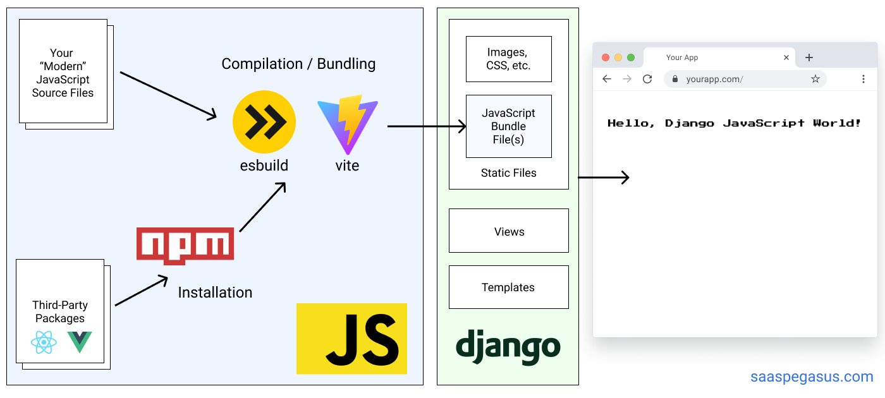

import { Aside } from '@astrojs/starlight/components';
import NodeVersion from '../../../components/NodeVersion.astro'

*This page documents the front end files that are integrated into Django.
See [the standalone front end docs](/experimental/react-front-end) for the separate React front end.*

## Architecture

Pegasus's front-end architecture is a hybrid model, with a front-end codebase
that is compiled and used directly in Django templates via Django's static files infrastructure.

Big picture, the front end is built with [Vite](https://vite.dev/), which compiles the front-end code into bundle
files that can be referenced using Django's static file system, as represented in the diagram below.



Note: Older versions of Pegasus supported a [Webpack-based setup](/front-end/webpack/), which is now deprecated.

Pegasus's styles use the [Tailwind](https://tailwindcss.com/) CSS framework,
and building the CSS files is included as part of the front-end build pipeline.
For more details on CSS in Pegasus, see the [CSS documentation](/css/overview).

**For a much more detailed overview of the rationale behind this architecture,
and the details of the set up see the [Modern JavaScript for Django Developers](https://www.saaspegasus.com/guides/modern-javascript-for-django-developers/)
series.**

## Front-end files

The source front-end files live in the `assets` directory, while the compiled files
get created in the `static` directory.

Generally you should only ever edit the front-end files in `assets` directly,
and use the tools described below to serve and build them.

## Prerequisites to building the front end

To compile the front-end JavaScript and CSS files it's expected that you have installed:

- [Node.js](https://nodejs.org/)
- [NPM](https://docs.npmjs.com/downloading-and-installing-node-js-and-npm)

Pegasus is developed and tested on the latest LTS releases, which (at the time of this writing)
are Node version <NodeVersion/> and npm 11.
Later versions will likely work, but aren't regularly-tested.

It's recommended to use [`nvm`](https://github.com/nvm-sh/nvm) to manage different node/npm environments more easily.
`nvm` is essentially `virtualenv` for Node.js/npm.

Alternatively, you can build and run your front end with Docker.
However, this has been known to cause performance problems in some environments.

## Initial setup

Once you've installed Node and NPM, you can install your front end dependencies by running:

```bash
npm install
```

or in Docker:

```bash
make npm-install
```

In your project's root directory.
This will install all the dependencies necessary to build the front end.

It will also generate a `package-lock.json` file.
**It is recommended that you add the `package-lock.json` to source control for consistency across installations.**

## Working with Vite and Django

Pegasus integrates Vite with Django using [django-vite](https://github.com/MrBin99/django-vite), which runs in one of two modes:

1. In *development*, front end assets are served directly from Vite's dev server.
2. In *production*, front end assets are built and served through Django's static files system.

This is controlled by the `dev_mode` setting in your [django-vite configuration](#django-vite-configuration),
which is tied to `settings.DEBUG` by default.

### Running in development

Vite does *not* use bundle files in development.
Instead, your front end files are served by Vite's development server (which is configured through `django-vite`).

This workflow gives you the benefit of added speed and fast page updates without reloading your browser,
but it does mean that **your Vite server must be running at all times during development**.

To run your Vite server and serve your front end files you should run:

```bash
npm run dev
```

Or in Docker:

```bash
make npm-dev
```

This command will also automatically refresh your front end whenever any changes are made.

### Adding files to Django templates

To add JavaScript files to Django templates you can use the `vite_asset` template tag from django-vite:

```jinja


```

For CSS files, use the `vite_asset_url` tag inside a regular stylesheet link:

```jinja

<link rel="stylesheet" href="">
```

If you are using React you also need to add the `vite_react_refresh` tag to get HMR working:

```jinja



```

### Building for production

To build for production, run:

```bash
npm run build
```

or in Docker:

```bash
make npm-build
```

This will minify and optimize your files.
In most [supported deployment set ups](/deployment/overview), this will be run automatically for you as part of your deployment.

In production, `settings.DEBUG` should be disabled via an environment variable,
which will in turn disable django-vite's dev mode.
Supported Pegasus deployments set this for you.

<Aside title="Environment variables and settings.DEBUG">
You should always override `settings.DEBUG` via an environment variable or `.env` file.
This ensures that the value is set at the top of `settings.py`, which in turn overrides the `dev_mode` setting
of `django-vite`. If instead you set `DEBUG = False` in `settings_production.py` this will not properly override
the value, and django-vite will still use dev mode in your production app.
</Aside>

If you need more fine-grained control, or want to test a production build, you can also explicitly
set the `DJANGO_VITE_DEV_MODE` environment variable to `false`.

You will also need to set up [Django's static file serving](/deployment/production-checklist/#check-your-static-file-setup).
Again, if you're using a supported Pegasus deployment mode, this should be already handled for you.

### django-vite configuration

The [django-vite docs](https://github.com/MrBin99/django-vite) provide details about the vite configuration.
Here is the relevant declaration from `settings.py`:

```python
DJANGO_VITE = {
    "default": {
        "dev_mode": env.bool("DJANGO_VITE_DEV_MODE", default=DEBUG),
        "dev_server_host": env("DJANGO_VITE_HOST", default="localhost"),
        "dev_server_port": env.int("DJANGO_VITE_PORT", default=5173),
        "manifest_path": BASE_DIR / "static" / ".vite" / "manifest.json",
    }
}
```

This should work without modification for most projects.
To change the Vite server's port, set the `DJANGO_VITE_PORT` environment variable,
which is read by both `vite.config.ts` and `django-vite`.
If you change the base path, you will have to make corresponding changes to your `django-vite` settings
as per their documentation.

## TypeScript and type checking

Pegasus includes TypeScript as part of the front end code.
You can write TypeScript or JavaScript code and it will be transpiled to work in a browser as part of the
build pipeline.

The build pipeline does *not* explicitly do type checking.
To do type checking you can run:

```bash
npm run type-check
```

Or in Docker:

```bash
make npm-type-check
```

Type checks will also automatically run on new pull requests if you have enabled Github Actions on your project.
