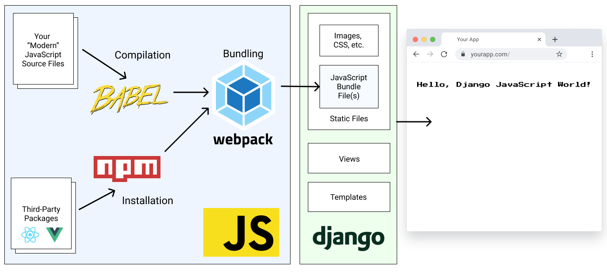

:::caution[Deprecated]
Webpack is deprecated in Pegasus. It will not receive
new features and support will be removed in a future release. Existing projects should [migrate to Vite](/front-end/migrating/).
:::

## Webpack architecture

The Webpack setup follows the same architecture as the Vite one, just with different tools:
[Webpack](https://webpack.js.org/) is the build tool, and [Babel](https://babeljs.io/) compiles the front-end code
into bundle files that are referenced using Django's static file system.



## Development with Webpack

Whenever you make modifications to the front-end files you will need to run
the following command to rebuild the compiled JS bundles and CSS files:

```bash
npm run dev
```

You can also set it up to watch for changes by running:

```bash
npm run dev-watch
```

or in Docker:

```bash
make npm-watch
```

## Bundled Static Files and Source Control

For ease of initial set up, the front-end bundle files can be optionally included with the Pegasus codebase.
This allows you to get up and running with Pegasus without having to set up the Webpack build pipeline.

However, keeping these files in source control will typically result in a lot of unnecessary changes and merge conflicts.
Instead, it is recommended that you add the compiled CSS and JavaScript bundle files to your `.gitignore`
so they are no longer managed by source control, and have your developers build them locally using the steps above.
**You can switch to this workflow by unchecking the "include static files" option in your project configuration.**

For production deployment, see the [production guidance](/deployment/production-checklist/#optimize-your-front-end) on this.

## Troubleshooting

### Changes are not being picked up when running `make npm-watch` in a Docker container

Some Docker configurations do not properly pick up file-system changes across operating systems.
This can be a problem, e.g. when running on certain Windows environments.
This causes changes made to not be automatically picked up.

This can be fixed by updating `webpack.config.js` to use polling by adding this:

```javascript
module.exports = {
   //...
   watchOptions: {
      poll: 1000,
   },
};
```

Alternatively, you can switch to installing/running NPM natively instead of in Docker.
This is a good option if you are also getting poor performance, which can also be caused
by cross-platform issues.
